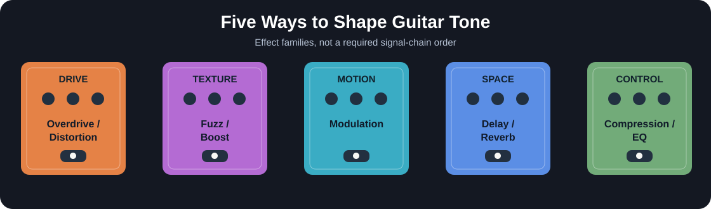

# Types of Guitar Pedals

Guitar pedals are tools for changing tone, dynamics, and the sense of space around a performance. This section explains five major groups of effects and shows practical ways to hear what each one contributes. The goal is not to memorize pedal names; it is to make informed decisions when building a sound for a riff, a lead, or an atmospheric introduction.

*Figure 1. Five ways to shape guitar tone. This diagram groups effects by purpose; it does not prescribe a pedal order.*

## Explore This Section

1. [[pedal-types/overdrive-and-distortion|Overdrive and Distortion]] — Gain, saturation, and clarity in heavy and clean sounds.
2. [[pedal-types/fuzz-and-boost|Fuzz and Boost]] — Textures, output level, and stacking gain stages.
3. [[pedal-types/delay-and-reverb|Delay and Reverb]] — Repeats, ambience, and spacious guitar layers.
4. [[pedal-types/modulation-effects|Modulation Effects]] — Chorus, phaser, flanger, and tremolo.
5. [[pedal-types/compression-and-eq|Compression and EQ]] — Dynamics, sustain, and frequency balance.

## How the Pages Connect

One effect rarely exists in isolation. A distortion pedal may be followed by delay for lead guitar, while a chorus and reverb combination may create a clean ambient layer. Compression and EQ can help either sound sit in an arrangement. These pages link to each other wherever the practical decisions overlap.

See also [[signal-chain/index|Signal Chain and Pedal Order]] to explore how placement changes the result.

## Further Reading

- [Fender: Beginner's Guide to Guitar Pedals](https://www.fender.com/articles/parts-and-accessories/beginner-guitar-pedals)
- [BOSS: The Ultimate Guide to Guitar Effects Pedal Order](https://articles.boss.info/the-ultimate-guide-to-guitar-effects-pedal-order-and-signal-chain/?lang=en-US)

**Don't imitate a sound. Create an identity.**