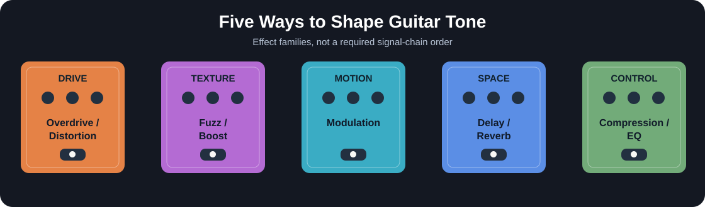

# Overdrive and Distortion

Overdrive and distortion both add grit to an electric guitar, but they do not always feel the same under your fingers. Overdrive generally reacts to how hard you play and can make an amplifier sound like it is being pushed. Distortion tends to produce a more consistently saturated sound, even when the picking gets softer. Neither effect is automatically “better”; the useful choice depends on the song and the amplifier.

## The Main Controls

Many drive pedals share three controls:

- **Drive or gain:** Changes how much the incoming signal is distorted.
- **Tone:** Adjusts brightness and the emphasis on high frequencies.
- **Level or volume:** Controls the output sent to the next pedal or amplifier.

A common mistake is turning every knob up. More gain can increase noise and make fast riffs less defined. In heavy music, a relatively low-drive overdrive placed before a high-gain amplifier can tighten the low end without adding as much extra saturation.

### A Practical Listening Test

1. Start with the amplifier's clean or mildly driven sound.
2. Set the pedal's drive low, tone near the middle, and level to match the bypassed volume.
3. Play the same palm-muted riff and open chord with the pedal on and off.
4. Increase the drive slowly and listen for changes in note separation, pick attack, and sustain.

For melodic metalcore, it is useful to compare tight rhythm guitar with a more spacious lead sound. The rhythm part often benefits from definition, while a lead may benefit from longer sustain. After choosing the gain texture, [[pedal-types/compression-and-eq|compression and EQ]] can help you understand dynamics and frequency balance.

> Good heavy tone is not just about maximum distortion; it is about keeping the notes understandable.

## Effects at a Glance

*Figure 1. An overview of common guitar-effect families. The diagram compares their roles, not their required order in a pedalboard.*

## Explore Related Effects

Compare saturated gain with [[pedal-types/fuzz-and-boost|fuzz and boost]], or learn how [[pedal-types/delay-and-reverb|delay and reverb]] can give driven leads more space. The location of these pedals in the rig also matters, as explained in [[signal-chain/index|signal chain and pedal order]].